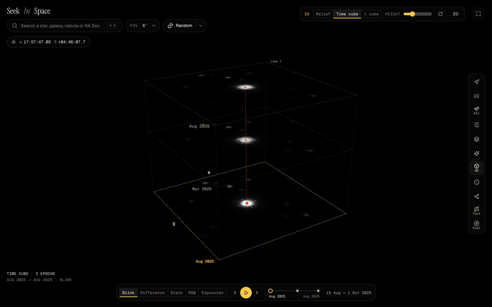
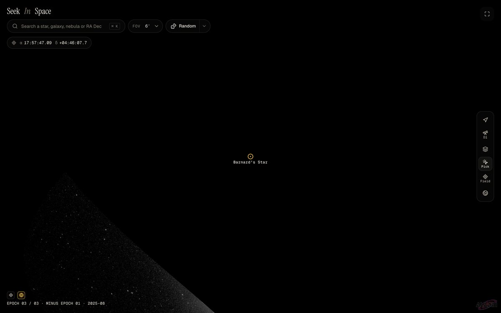
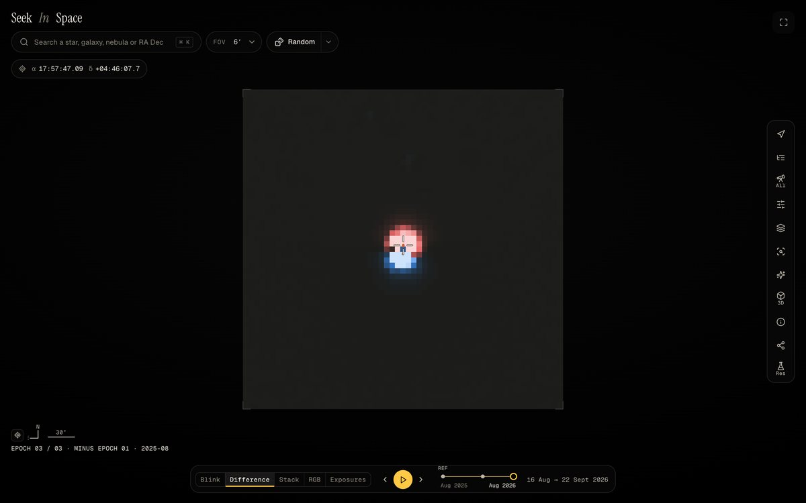
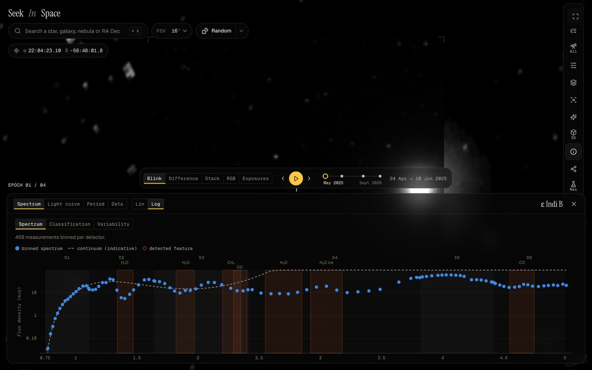
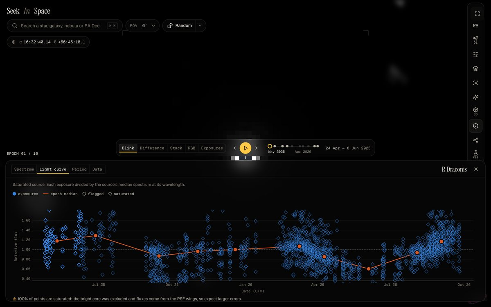
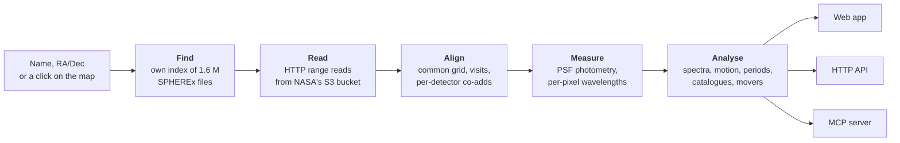

<div align="center">

# Seek In Space

### Watch the infrared sky move.

A public time machine for NASA's **SPHEREx** all-sky survey. Name a star or click anywhere on the sky, and watch that patch change across every SPHEREx visit, with spectra, light curves and motion measured for you.

**[▶ Open seekin.space](https://seekin.space)** &nbsp;·&nbsp; [Presentation](docs/presentation.pdf) &nbsp;·&nbsp; [How it works](#how-it-works) &nbsp;·&nbsp; [For AI agents](#for-ai-agents-mcp) &nbsp;·&nbsp; [Docs](#documentation)

NASA Space Apps Challenge 2026 &nbsp;·&nbsp; Challenge: [Planet X and SPHEREx](https://www.spaceappschallenge.org/2026/challenges/planet-x-and-spherex/) &nbsp;·&nbsp; Team NUPASA



</div>

## Why

Since May 2025 SPHEREx has photographed the whole sky every six months in 102 infrared colours (0.75–5 µm). Objects that move or change between visits (nearby brown dwarfs, fast stars, asteroids, comets, variable stars) show up when you compare those images, the way Pluto was found by blinking two plates in 1930 and the way Backyard Worlds volunteers found hundreds of brown dwarfs with WiseView on WISE data.

Seek In Space is that kind of tool for SPHEREx: it finds the images of a spot in the indexed releases, reads only the pixels it needs from NASA's open cloud bucket, aligns them, and plays them as a movie in your browser. It measures what it shows, too.

## Try it in 30 seconds

| Open | What you will see |
|---|---|
| [**Barnard's Star**](https://seekin.space/?target=barnard&mode=diff) | The fastest-moving star: the red–blue pair is where it was and where it is a year later |
| [**Barnard's Star in 3D**](https://seekin.space/?target=barnard&v3d=time) | Time stacked upward: the star's track climbs through three visits |
| [**ε Indi B**](https://seekin.space/?target=eps-indi-b) | A brown dwarf binary; open *Spectrum* to see water and methane bands and a T-dwarf-like classification |
| [**WISE 0855−0714**](https://seekin.space/?target=wise-0855&mode=rgb) | The coldest known brown dwarf (~285 K): a moving source at the long-wavelength end, next to a brighter star |
| [**R Draconis**](https://seekin.space/?target=r-dra) | A Mira variable in 2,493 exposures; open *Light curve* and *Period* |
| [**RW Aurigae**](https://seekin.space/?target=rw-aur) | A young star that faded by about half at 4–5 µm within a year |

Or type any name or coordinates into the search box, press **Random**, or zoom out to the all-sky map and click anywhere. Every view is a link you can share or embed.

<table>
<tr>
<td width="50%"><br><sub><b>All-sky map.</b> SPHEREx's own all-sky image (HiPS) on Aladin Lite; click anywhere to build a sequence there.</sub></td>
<td width="50%"><br><sub><b>Blink and difference.</b> Every visit aligned north-up; the star's motion shows as a red–blue pair.</sub></td>
</tr>
<tr>
<td width="50%"><br><sub><b>Spectrum on click.</b> 102 bands with features found automatically and a template classification.</sub></td>
<td width="50%"><br><sub><b>Light curves and periods.</b> Every exposure, per-visit medians and a Lomb–Scargle periodogram.</sub></td>
</tr>
</table>

## Features

### See

- **Five ways to compare visits:** blink, difference, stack, false-colour RGB across the six detectors, and single exposures.
- **3D views:** relief, a *time cube* (visits stacked in time) and a *λ cube* (the field stacked by wavelength).
- **All-sky map** of SPHEREx's own HiPS on Aladin Lite, served from our cache, with one camera shared by the map and the field.
- **Overlays at the right date:** Gaia DR3 and CatWISE2020 moved to the date of the visit you are looking at, 2MASS at its own epoch, and known asteroids and comets where they were at that moment.
- **Search as you type** over ~4,500 named objects with aliases and typo tolerance, plus coordinates in any common format and CDS Sesame for everything else. A *Random* button explores objects or empty sky.
- **Field of view** from 2′ to 30′, any detector or all six, and your choice of stretch and colour map.

### Measure

- **Photometry with the detector's own PSF** and the exact wavelength of every pixel. Saturated stars are measured in a ring outside the core, as relative fluxes, and labelled as such.
- **102-band spectra** with water, methane, CO, CO₂ and ice features, the closest stellar or M/L/T-dwarf template, infrared-excess and composite detection, and spectral variability between visits.
- **Light curves and periodograms**, plus **proper motion** fitted to per-visit centroids.
- **Click anywhere** for an instant flux estimate. *Analyze* runs the full set of checks and ends with a plain-language verdict.

### Discover

- **Whole-field search:** sources, movers, variables and red, cold brown-dwarf candidates. A classifier trained on injected sources filters moving-object detections.
- **Solar system:** moving-object detection and tracklets, Track & Stack within a visit, and known objects computed from SPHEREx's own position. IRSA MOST finds every exposure of a named asteroid or comet, and a *co-moving* sequence keeps it centred while the stars trail.
- **Comets:** coma, tail and CO₂-band tests give a 0–100 comet-likeness score, a heuristic ranking rather than a probability (the known comet 3I/ATLAS scores 99.9; the asteroids 433 Eros and 16 Psyche score ≤ 1). A *Comet hunt* panel and a watch list of bright comets are included.
- **26-year baseline:** 2MASS (1999), AllWISE (2010) and NEOWISE (2014–2024) frames on the same grid, with SPHEREx tied to the WISE bands, for long-term motion and long-period variables.

### Share and export

- FITS co-adds with WCS, photometry as CSV or VOTable, **ADES** reports for the Minor Planet Center, and a script that downloads the original files.
- Every view lives in its URL, and the *Share* panel gives an embeddable `<iframe>`.

### For everyone

- **Explore mode** for newcomers: plain language, fewer controls, a guided tour of the five challenge targets and a *find it yourself* game.
- **Research mode** for scientists: fluxes with errors, flags, χ², wavelengths and every export.

## For AI agents (MCP)

Seek In Space includes a [Model Context Protocol](https://modelcontextprotocol.io) server with **30 tools**: resolve targets, build sequences, fetch images, analyse a point or a whole field, search for moving objects and comets, match catalogues and export reports. An assistant such as Claude can chain them into a search-and-verify loop; [`scripts/mcp_discovery_demo.py`](scripts/mcp_discovery_demo.py) runs one in the ε Indi field.

```bash
claude mcp add seek-in-space --transport http https://seekin.space/mcp
```

Tool list and examples: [docs/mcp.md](docs/mcp.md).

## Validated on the five challenge targets

| Target | What it is | What we measured |
|---|---|---|
| Barnard's Star | The fastest-moving star (10.4″/yr) | Three visit centroids lie within 0.5″ of the linear Gaia-motion prediction; about 4.4′ of motion between the 2MASS epoch (2000) and SPHEREx (2026) |
| ε Indi B | T1 + T6 brown dwarf binary, unresolved | T-dwarf-like spectrum (closest standard T3) with strong 3.3 µm methane; motion 4.42 ± 0.29″/yr against 4.68″/yr from Gaia |
| WISE 0855−0714 | The coldest known brown dwarf | A moving 3.8–5 µm excess consistent with a ~285 K object; a star 8″ away dominates the shorter wavelengths |
| R Draconis | Mira variable | SPHEREx-only period estimates of 235.7 and 246.9 days from two models, against ~246 days in the catalogue |
| RW Aurigae | Young T Tauri binary | Faded by about 1.9× at 4–5 µm between the first and last visits (relative photometry of a saturated star) |

Synthetic J/H/Ks photometry of an isolated comparison star agrees with 2MASS to about 2 %; broader absolute calibration is still being validated. Details, plots and caveats: [docs/methods.md](docs/methods.md) and [analysis/validation/REPORT.md](analysis/validation/REPORT.md).

## How it works



1. **Find:** a local index of all 1,628,230 SPHEREx DR1 and weekly QR3 Level 2 files answers in about 90 ms (median over 200 random positions) and keeps working when IRSA's services are down. IRSA TAP and SIA are fallbacks, and the index re-syncs every hour.
2. **Read:** each 64 MB file is read with HTTP range requests, about 2 MB per exposure for a 6′ field, matching astropy exactly in our tests, compressed flag maps included. IRSA's cutout service is used when it is fast.
3. **Align:** every exposure is resampled onto one north-up grid, grouped into visits, and co-added per detector with outlier rejection and flag masking. Proper motion keeps fast stars on target.
4. **Measure and analyse:** forced photometry with each file's own PSF gives a spectrum per visit and a light curve; the analyses above run on top.

A cached field opens in seconds (358 exposures of Barnard's Star in about 5 s). A position nobody asked for before takes 6–13 s for about 200 exposures on our server next to the data.

**Stack:** Python (astropy, photutils, NumPy/SciPy, FastAPI, asyncio/aiohttp, a process pool and a cancellable job queue) · React + TypeScript + Vite · Aladin Lite · three.js · MCP SDK. Design decisions are recorded in 63 [architecture decision records](docs/adr/README.md).

## How it answers the challenge

| The challenge asks for | Seek In Space |
|---|---|
| A public web tool: enter RA/Dec, see a time series played like a video | ✅ Any position, name or map click; blink, difference, stack, RGB, 3D time cube |
| Easy updates as new releases arrive | ✅ DR1 and the weekly QR3 data are indexed automatically (the file index re-syncs every hour), and a sequence can be rebuilt to pick up new exposures; [`/api/releases`](https://seekin.space/api/releases) reports what is available |
| Creative use of the 102 bands: per-detector co-adds, spectra on the fly | ✅ Six-detector co-adds, RGB across detectors, 102-band spectra with template matching, λ cube |
| Adding or subtracting epochs | ✅ Difference against any reference visit, stacks of any set of visits |
| User-selectable field of view | ✅ 2′ to 30′ |
| Overlays from Gaia and WISE | ✅ Gaia DR3 and CatWISE2020 at each visit's date, plus 2MASS and known solar-system objects |
| Coordinates in the URL so the tool can be embedded | ✅ Every view is a URL; embeddable `<iframe>` |
| Metadata such as contamination flags | ✅ Flags per visit and detector, read from the files themselves |
| Reuse of existing tools (Astropy, Aladin) | ✅ Astropy and photutils in the pipeline, Aladin Lite for the sky map |

## Quick start

The live site needs nothing installed. To run your own copy (Python 3.11+, Node 20+):

```bash
uv pip install -e "backend[dev]"
```

```bash
npm --prefix web ci && npm --prefix web run build
```

```bash
SPHEREX_CACHE_DIR=./cache uvicorn spherex_api.main:app --port 8000
```

Then open http://localhost:8000. Reading SPHEREx data is fastest from a machine in US-East, near the S3 bucket. Tests: `pytest -m "not network"` in `backend/` and `npm --prefix web test`. Development, deploy and the production setup are described in [docs/development.md](docs/development.md).

## Documentation

| Document | What is in it |
|---|---|
| [Presentation](docs/presentation.pdf) | The 7-slide project deck |
| [Architecture](docs/architecture.md) | Components, request lifecycle, module map |
| [SPHEREx data for developers](docs/data.md) | Detectors, releases, file layout, flags, wavelengths, access |
| [Methods](docs/methods.md) | Pipeline parameters, validation, known limitations |
| [HTTP API](docs/api.md) | Every endpoint, with examples |
| [MCP server](docs/mcp.md) | Tools for AI agents |
| [Data access and performance](docs/data-access-performance.md) | Mirrors, fallbacks, caching and timings |
| [Development](docs/development.md) | Setup, tests, deploy, production server |
| [Architecture decision records](docs/adr/README.md) | 63 decisions and why we made them |

## Limitations

- No confirmed discovery yet, only candidates.
- Our non-polar showcase fields have 3–4 SPHEREx visits so far; motion and variability get better with every release.
- Saturated stars get relative photometry only, with epoch-to-epoch systematics of up to ~15 %.
- Scores and template weights (comet-likeness, classification) are heuristic rankings, not calibrated probabilities.
- The comet search confirms known movers well but does not yet find fast comets from a single pass.
- Long-baseline frames and some catalogue overlays depend on IRSA services, which are sometimes down.

## Acknowledgements

This publication makes use of data products from the Spectro-Photometer for the History of the Universe, Epoch of Reionization and Ices Explorer (SPHEREx), which is a joint project of the Jet Propulsion Laboratory and the California Institute of Technology, and is funded by the National Aeronautics and Space Administration.

It also uses data from the European Space Agency mission Gaia, processed by the Gaia Data Processing and Analysis Consortium; from 2MASS, WISE and NEOWISE through NASA/IPAC's Infrared Science Archive (IRSA); and services from CDS Strasbourg (Aladin Lite, SIMBAD, Sesame) and JPL's Solar System Dynamics group. Thanks to the WiseView and Backyard Worlds projects, whose blink tools inspired this one.
