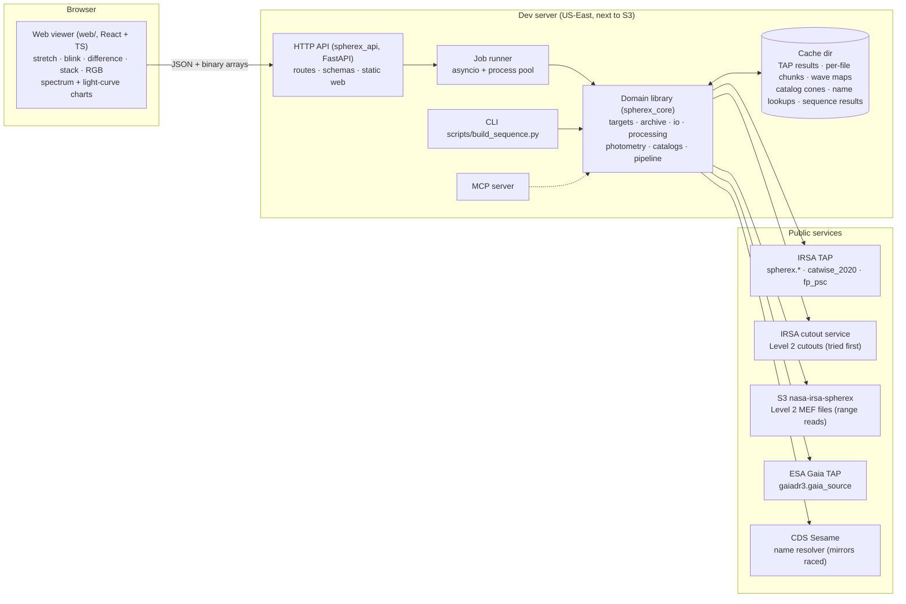

# Architecture

Seek In Space is a modular monolith ([ADR-0004](adr/0004-modular-monolith.md)): one Python domain library that knows SPHEREx, thin adapters that expose it (the HTTP API, the MCP server for AI agents at `/mcp`, a CLI for operators), and a static web client. This page shows how the pieces connect and how one request flows through them.

## Components and data flow



- The **web viewer** never talks to archives directly. It downloads one sequence (metadata plus typed arrays) and does every display operation locally ([ADR-0005](adr/0005-server-side-alignment-client-side-display.md)). Search suggestions are computed in the browser from a local index of about 4,500 SIMBAD objects fetched once from `/api/objects` ([ADR-0021](adr/0021-local-object-index-for-search.md)).
- The **HTTP API** validates requests, starts or reuses jobs, streams result files and proxies catalogue cones.
- The **domain library** contains all SPHEREx knowledge and has no web dependencies, so the CLI and the future MCP server call exactly the same code.
- **External services:** IRSA TAP for discovering images and for CatWISE/2MASS, the public S3 bucket for pixels, ESA Gaia TAP for Gaia DR3, SIMBAD TAP (CDS, CfA mirror) for named objects, CDS Sesame for names the local object index does not know, cached for 30 days ([ADR-0011](adr/0011-name-resolution-and-catalogs.md), [ADR-0021](adr/0021-local-object-index-for-search.md)).

## Request lifecycle

```mermaid
sequenceDiagram
  participant B as Browser
  participant A as API
  participant J as Job runner
  participant P as Pipeline
  participant X as IRSA (TAP, cutouts) / S3
  B->>A: POST /api/sequences {ra, dec, pmra, pmdec, ref_epoch, fov_arcmin, ...}
  A->>J: submit(params); id = hash(params)
  alt result already on disk
    J-->>A: status done
  else new request
    J->>P: build_sequence(params) in the background
    P->>X: TAP query (cached 12 h)
    P->>X: batches on the process pool: IRSA cutout (1 request) or S3 range reads (~3 rounds), opening epoch first
    P->>P: align and photometry per exposure (pool), then epochs and co-adds
    P-->>J: writes sequences/<id>p1/, p2/ ... (previews of finished epochs), then sequences/<id>/
  end
  A-->>B: {id, status, stage, done, total}
  loop until 200
    B->>A: GET /api/sequences/{id}
    A-->>B: 202 + progress, preview id (or 500 + error, 410 if cancelled)
    opt a new preview
      B->>A: GET /api/sequences/{preview}/lite and its planes (shown at once)
    end
  end
  opt target or field of view changed, page closed
    B->>A: DELETE /api/sequences/{id} (build cancelled when nobody waits)
  end
  A-->>B: 200 meta.json
  B->>A: GET /api/sequences/{id}/coadds.bin, coverage.bin, flags.bin
  B->>A: GET /api/sequences/{id}/exposures.bin?epoch=&band= (on demand)
  B->>A: GET /api/catalogs/{gaia|catwise|2mass}?ra=&dec=&radius_arcmin=
```

The sequence id is the hash of the normalised request ([ADR-0012](adr/0012-caching.md)), so identical requests from different users share one job and one result. A job progresses through the stages `search` → `fetch` (with `done`/`total` exposures) → `stack` → `done`.

## Pipeline

| Stage | What happens | Decision |
|---|---|---|
| Search | TAP query for images containing the target's 2026.0 position; one image per exposure and detector, DR1 preferred | [ADR-0003](adr/0003-tap-image-discovery.md) |
| Grid | TAN, north up, native 6.15″ pixels, centred on the target at the median epoch | [ADR-0006](adr/0006-common-output-grid.md) |
| Read | `IMAGE`, `FLAGS`, `VARIANCE` from IRSA's cutout service, or as range reads of rows from S3 when it is busy; rows cached per file, `VARIANCE` only near the target; wavelength and ePSF tables once per detector | [ADR-0002](adr/0002-s3-range-reads.md), [ADR-0016](adr/0016-epsf-psf-photometry.md), [ADR-0037](adr/0037-per-file-chunk-cache.md), [ADR-0038](adr/0038-irsa-cutouts.md) |
| Per exposure | mask, subtract background, align to the grid (NaN-aware), ePSF photometry with aperture fallback at the propagated position | [ADR-0010](adr/0010-proper-motion-aware-targets.md), [ADR-0016](adr/0016-epsf-psf-photometry.md), [ADR-0017](adr/0017-nan-aware-resampling-and-filled-coadds.md), [ADR-0018](adr/0018-photometry-flag-policy.md) |
| Assemble | group into epochs and merge small ones, co-add per detector with outlier rejection, fill fully masked pixels (`FILLED`), OR flags, write arrays and `meta.json` | [ADR-0007](adr/0007-epochs-and-coadds.md), [ADR-0017](adr/0017-nan-aware-resampling-and-filled-coadds.md), [ADR-0019](adr/0019-merge-small-epochs.md) |

Reading and per-exposure work run together in a shared process pool: each worker takes a batch of 2–16 exposures, reads them on its own event loop and processes them, so every core parses headers and decodes FLAGS ([ADR-0013](adr/0013-process-pool-and-slim-headers.md), [ADR-0039](adr/0039-batched-fetch-and-previews.md)). The epoch the viewer opens on is read first, and previews of the finished epochs are published while the rest is read. Details and parameters are in [methods.md](methods.md).

## Caching

Six layers under `SPHEREX_CACHE_DIR`: archive query results (12 h), one chunk of rows per Level 2 file (permanent, [ADR-0037](adr/0037-per-file-chunk-cache.md)), per-detector wavelength maps and ePSF tables (permanent), catalogue cones (7 days) and sequence results (permanent, written atomically). Keys and lifetimes are in [ADR-0012](adr/0012-caching.md).

## Backend module map

> **Target layout, being applied.** The backend is being restructured into the layout below; the table at the end maps today's files to it. This section will be updated when the restructuring lands.

```
backend/
  spherex_core/            domain library, no web framework imports
    config.py              settings from SPHEREX_* environment variables
    bands.py               detectors D1–D6, wavelength ranges, native pixel scale
    timeutil.py            MJD ↔ Julian year ↔ display strings
    flags.py               flag bit names, the masks the pipeline applies, MSKN/MSKD parsing
    cache.py               every on-disk cache location and key
    errors.py              exceptions shared by the library and its adapters
    targets/               Target model with proper motion, presets, coordinate parser, name resolution,
                           objects.json (local SIMBAD object index) and its loader
    archive/               generic TAP client, SPHEREx Level 2 image search
    io/                    HTTP range client, IRSA cutout client, FITS header helpers, Level 2 cutout and wavelength reader
    processing/            output grid and resampling, background, epochs, co-adds
    photometry.py          forced aperture photometry
    catalogs/              Gaia DR3, CatWISE2020, 2MASS, SIMBAD behind one cone() function
    pipeline/              sequence parameters, per-exposure work, assembly, result format, background jobs
    solar/                 co-moving science (ADR-0060): static-sky subtraction (build step), footprints and
                           the MOST fixed-point search, SPHEREx-centric geometry, solar spectrum, comet,
                           asteroid and unknown-mover analyses (field jobs), their use cases (service.py)
    services.py            facade called by every adapter (HTTP, MCP, CLI)
  spherex_api/             HTTP adapter
    app.py                 FastAPI app, middleware, static web files
    schemas.py             request and response models
    routes/                health, targets, sequences, catalogs, solar (static sky, comet, asteroid, movers)
  tests/
```

| Current file | Target module(s) |
|---|---|
| `spherex_core/config.py` | `config.py` |
| `spherex_core/targets.py` | `targets/`, `timeutil.py` |
| `spherex_core/archive.py` | `archive/`, `bands.py` |
| `spherex_core/remote_fits.py` | `io/` |
| `spherex_core/processing.py` | `processing/`, `flags.py` |
| `spherex_core/photometry.py` | `photometry.py` |
| `spherex_core/catalogs.py` | `catalogs/` |
| `spherex_core/sequence.py` | `pipeline/`, `cache.py` |
| `spherex_api/main.py` | `app.py`, `schemas.py`, `routes/` |
| `spherex_api/jobs.py` | `pipeline/` (background jobs), exposed through `services.py` |

## Deployment (development)

One vast.ai instance in Pennsylvania, next to the data ([ADR-0014](adr/0014-dev-compute-on-vast-ai.md)). `scripts/deploy.sh` syncs the repository, installs the backend into `/workspace/venv` and runs uvicorn in a `tmux` session; the API also serves the built web app. See [development.md](development.md).

## Path to services

The seams for a later split are already in the code ([ADR-0004](adr/0004-modular-monolith.md)): `api` (stateless HTTP and static files), `worker` (the job runner and pipeline), `mcp` (another adapter over `services`), and `web` (static files). Because each result is a self-contained directory, `api` and `worker` only need shared storage to run as separate processes or machines.
