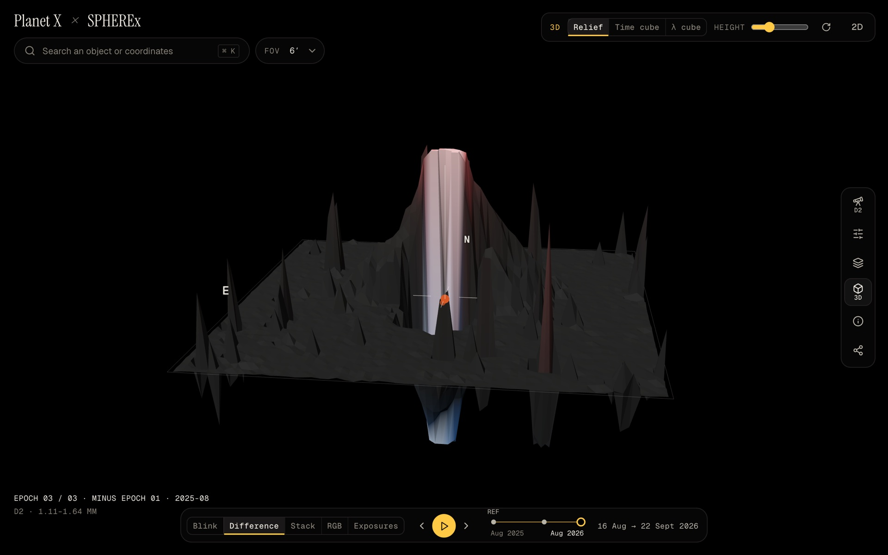

# Web viewer

React + TypeScript single-page app (Vite, no UI framework). It asks the API to build a time sequence for a
sky position, downloads the aligned epoch co-adds as raw arrays and does all display work in the browser:
stretching, blinking, differences, stacks, false colour, overlays and charts.

## Run it

```bash
cd web
npm install
npm run dev          # http://localhost:5173, /api is proxied to the API
```

The dev server proxies `/api` to `API_URL`, read from the environment or from `../.env.deploy`
(see `../.env.example`), falling back to `http://localhost:8000`. To point at another backend:

```bash
API_URL=http://localhost:8000 npm run dev
```

`npm run build` type-checks and writes `dist/`. The FastAPI app serves `web/dist` at `/` when it exists,
so after `scripts/deploy.sh` the whole tool is one URL and the client uses relative `/api` paths.
`VITE_API_BASE` can prefix API calls if the app is hosted elsewhere.

## Structure

```
src/
  api.ts            the only module that talks to the API: fetch with retries, job polling,
                    binary array decoding (coadds/coverage/flags/exposures), catalogs
  state.ts          view state, defaults, URL parsing/serialisation and writeUrl() (the only URL writer)
  render.ts         pure pixel math, no React: percentiles, robust noise, Derived (S/N "All" image,
                    false-colour groups, stacks, differences, flag maps), colour maps, canvas painting
  display.ts        what the viewer shows for a mode (pure): limits over all epochs, reference epoch,
                    playable epochs (partial visits skipped unless asked)
  astro.ts          TAN projection onto the grid, proper-motion propagation, coordinate/date formatting
  photometry.ts     shared presentation of measurements (method, saturation, relative-only points)
  colors.ts         palette slots used by charts and overlays (validated dataviz values; never the UI accent)
  hooks.ts          element size, media query, viewport height, dismiss-on-outside-click, safe localStorage
  types.ts          API payload types (meta.json, jobs, catalogs)
  App.tsx           wiring and layout: target -> build -> derived images -> sections; playback, keys
  components/
    SkyView.tsx        full-bleed sky: drag, wheel/pinch zoom around the cursor, double-click, click-to-select,
                       hairline overlays in screen space, minimal HUD, HUD loader
    Sky3D.tsx          3D views (three.js, lazy chunk): relief of the frame, time cube, λ cube; orbit, pick a layer
    TopBar.tsx         floating top-left: serif wordmark, search pill, FOV; the share panel
    CommandSearch.tsx  ⌘K / Ctrl+K search with the challenge targets as quick picks
    Transport.tsx      floating dock (prev / play / next, epoch scrubber, date) and playback options
    Rail.tsx           right tool rail: Detector, Display, Layers, 3D, Details, Share
    Controls.tsx       mode control, detector panel, Display and Layers panels, the 3D bar
    Drawer.tsx         closed-by-default drawer: Spectrum · Light curve · Data (lazy chunks)
    SidePanel.tsx      the Data tab: Overview · Epoch · Flags · Data
    Progress.tsx       top progress bar and the landing index over the sky
    ui/primitives.tsx  popover, segmented control, tabs, switch, micro label
    chart/             ChartFrame (reusable SVG chart), SpectrumChart, LightCurveChart, PeriodogramChart
```

Nothing about the instrument is hard-coded: detector ids, order and wavelength ranges come from
`meta.bands`, epochs from `meta.epochs`, flag names from `meta.flag_bits`. The false-colour channels are
the detectors split into three wavelength groups (longest = red). Targets may carry `default_band` and
`default_mode` hints from the API; they apply unless the URL sets band or mode.

## Loading and caching

Everything goes through `src/api.ts`; each newer endpoint falls back to the older API when it is missing.

- Every request sends `X-Client-Id` (one random id per tab), so the server counts interest per tab.
- One AbortController per load: changing target or FOV cancels polls and downloads; an unfinished job is
  withdrawn with `DELETE /api/sequences/{id}` (also on `pagehide`, via `fetch(..., {keepalive: true})`).
- Polling `GET /api/sequences/{id}` is the heartbeat: every 1 s while visible, 10 s while hidden. `202`
  shows the stage (incl. "publish"), `410` re-POSTs to restart, `500` is an error. When it turns `200` the
  big body is cancelled and the small `/lite` metadata is fetched instead (full meta if there is no `/lite`).
- `429` + `Retry-After` shows a "many users right now" countdown and retries.
- Images are fetched one `[n, n]` plane at a time (`{coadds|coverage|flags}.bin?epoch=&band=`), only for
  what is on screen: the current epoch/detector(s), the reference in Difference, coverage only for Stack,
  flags only with the flag layer on. Neighbouring epochs are fetched next; while playing, every playable
  epoch. When more than half of a cube is missing and wanted (e.g. playing All/RGB), the whole cube comes in
  one request. Decoded planes live in a 320 MB LRU keyed by sequence + array + epoch + band. The previous
  frame stays on screen while the next one downloads; stretch limits use the epochs already in memory.
- The exposure and photometry tables arrive as columns (`/columns/{table}`) only when needed: photometry
  when the drawer opens, exposures in Exposures mode or the Data tab.
- Catalogs load only when their layer is on (browser-cached via ETag/max-age); chart code loads only when
  the drawer opens. The only prefetch is a preset's lite metadata on hover in the landing index.
- Analysis: the Period tab calls `GET .../periodogram` (or `POST /api/periodogram` for a measured source);
  "Measure spectrum & light curve" on a catalogue source calls `POST .../photometry` and shows that source
  in the drawer; Share → Download links the `export/*` files.

## Design

Google-Earth model on black: the sky fills the viewport and every control floats over it as small glass
panels (search pill, dock, tool rail, drawer); hairline reticle around the image, minimal mono HUD. Type is
self-hosted: Geist (UI), Geist Mono (data and HUD) and Instrument Serif (display), from `@fontsource`.
One amber accent (`#ffc845`) marks active and focus states only; all data colours come from the dataviz
palette in `colors.ts` (contamination flags use the status red so they cannot be confused with the
accent). Blinking is instant; a new target plays a short lock-on animation.

## 3D views

The rail's 3D button (or `v`) opens one of three views ([ADR-0021](../docs/adr/0021-3d-views.md)). They are
independent of the mode and use the same stretch, colour map and percentile limits as the flat sky:

- **Relief**: the frame on screen as a height field. Height is signal-to-noise above the sky on a log scale (flat
  within 2σ, 1 at 200σ). Colours follow the stretch and colour map. Stars are peaks. In Difference a mover is a red
  peak (now) beside a blue pit (then).
- **Time cube**: every epoch as a glowing layer at its date, with the sky transparent. A still star is a vertical
  column, and a mover leans along the predicted track (orange) that threads the epochs. In Exposures mode with one
  detector, the layers are that visit's single exposures at their times, so a source that moves during the visit,
  such as an asteroid, traces a straight diagonal.
- **λ cube**: every detector of the current epoch, short to long wavelength. A source lights up only in the layers
  where it is bright.

Drag to orbit, right-drag to pan, scroll to zoom, double-click to reset. Click a layer's label to show that epoch
or detector. The bar at the top right switches the view, sets the height, spins the scene and goes back to 2D.
North is the far side and east is left. three.js loads only when a 3D view opens.

| Relief, Difference, seen from the side | Time cube, Blink, D2 |
|---|---|
|  |  |
| **Time cube, Exposures**: 18 single exposures of one visit | **λ cube**: the six detectors of one epoch (WISE 0855 field) |
|  |  |

## URL parameters

Every view is reproducible from its URL; the app keeps the address bar in sync.

| Parameter | Meaning |
|---|---|
| `target` | preset id from `/api/targets` (`barnard`, `eps-indi-b`, `wise-0855`, `rw-aur`, `r-dra`) |
| `ra`, `dec` | position in degrees (ICRS), instead of `target` |
| `pmra`, `pmdec`, `ref_epoch` | proper motion in mas/yr (pmra includes cos dec) and the Julian year of `ra`/`dec` |
| `name` | label for a custom position |
| `fov` | field of view in arcmin (1–30) |
| `mode` | `blink` (default), `diff`, `stack`, `rgb`, `exp` |
| `band` | `D1`…`D6` or `all` (noise-weighted combination) |
| `epoch` | epoch index shown |
| `ref` | reference epoch for `diff` |
| `stack` | comma-separated epoch indices for `stack` |
| `speed` | milliseconds per frame |
| `ends=1` | blink only the first and last epoch |
| `partial=1` | include partial visits in playback |
| `stretch` | `asinh` (default), `linear`, `log` |
| `lo`, `hi` | black and white points in percent (computed over all epochs) |
| `cmap` | `gray` or `ice` |
| `zoom` | integer zoom, `0` = fit |
| `smooth=1` | smooth instead of crisp pixels |
| `ov` | overlays: `target,track,gaia,catwise,2mass,flags,compass` |
| `flags` | flag bit numbers drawn by the flags overlay |
| `ylog=0` | linear flux axis in the spectrum |
| `v3d` | 3D view: `relief`, `time` (epochs stacked by date) or `bands` (detectors stacked by wavelength) |
| `h3d` | vertical exaggeration of the 3D view (default 1) |
| `embed=1` | viewer and its controls only, for iframes |

Example: `/?target=barnard&mode=diff&band=D2&epoch=4` shows Barnard's Star in D2 minus the first visit:
the star leaves a red (now) and blue (then) pair, offset to the north.

## Keyboard

Space play/pause · ← → previous/next epoch · 1–6 detector · 0 all detectors · b d s r e modes · v 3D on/off.
