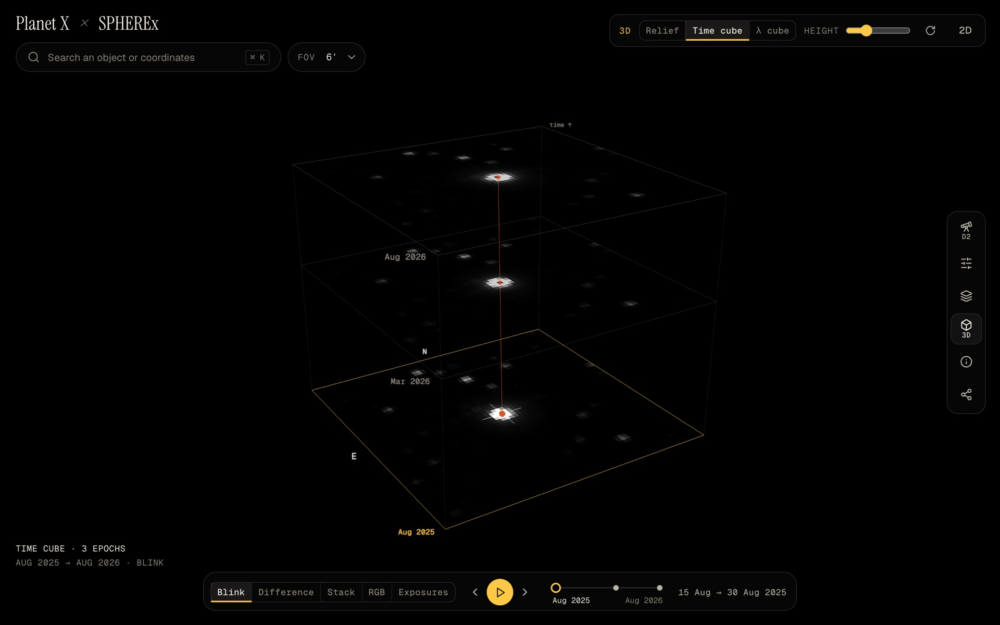
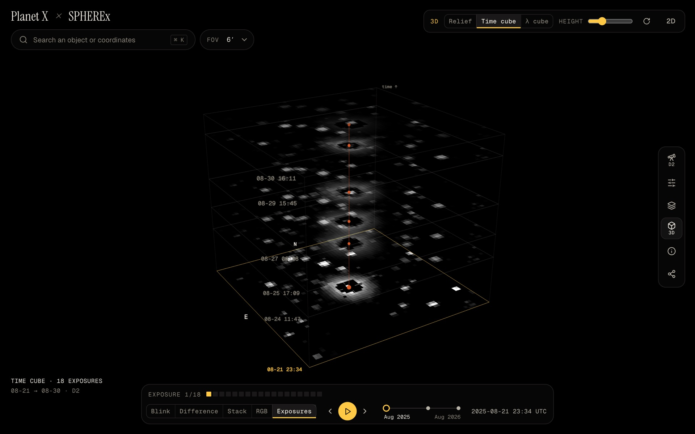
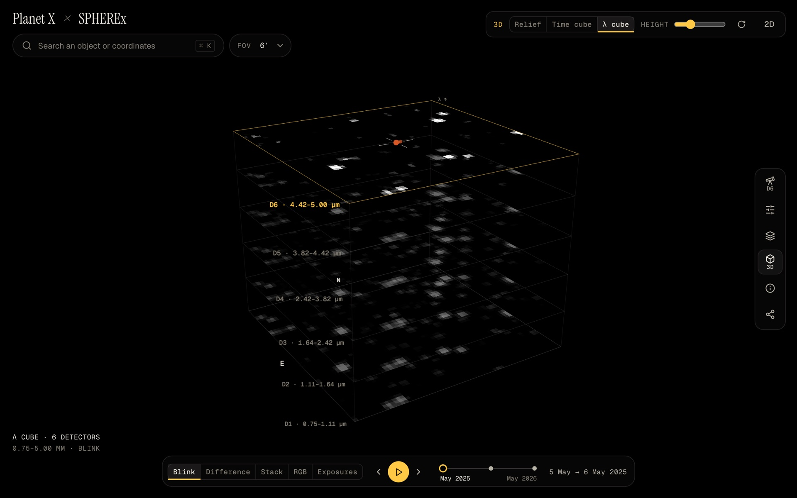

# Web viewer

React + TypeScript single-page app (Vite, no UI framework). It asks the API to build a time sequence for a
sky position, downloads the aligned epoch co-adds as raw arrays and does all display work in the browser:
stretching, blinking, differences, stacks, false colour, overlays and charts.

## Run it

```bash
cd web
npm install
npm run dev          # http://localhost:5173, /api is proxied to the API
```

The dev server proxies `/api` to `API_URL`, read from the environment or from `../.env.deploy`
(see `../.env.example`), falling back to `http://localhost:8000`. To point at another backend:

```bash
API_URL=http://localhost:8000 npm run dev
```

`npm run build` type-checks and writes `dist/`. The FastAPI app serves `web/dist` at `/` when it exists,
so after `scripts/deploy.sh` the whole tool is one URL and the client uses relative `/api` paths.
`VITE_API_BASE` can prefix API calls if the app is hosted elsewhere.

## Structure

```
src/
  api.ts            the only module that talks to the API: fetch with retries, job polling,
                    binary array decoding (coadds/coverage/flags/exposures), catalogs
  state.ts          view state, defaults, URL parsing/serialisation and writeUrl() (the only URL writer)
  render.ts         pure pixel math, no React: percentiles, robust noise, Derived (S/N "All" image,
                    false-colour groups, stacks, differences, flag maps), colour maps, canvas painting
  display.ts        what the viewer shows for a mode (pure): limits over all epochs, reference epoch,
                    playable epochs (partial visits skipped unless asked)
  astro.ts          TAN projection onto the grid, proper-motion propagation, coordinate/date formatting
  search.ts         search without React: name normalisation (same rules as the backend), ranking with
                    typo tolerance, object-type facets, coordinate parsing, nearby objects, Random draws,
                    recent picks in localStorage
  photometry.ts     shared presentation of measurements (method, saturation, relative-only points)
  colors.ts         palette slots used by charts and overlays (validated dataviz values; never the UI accent)
  hooks.ts          element size, media query, viewport height, dismiss-on-outside-click, safe localStorage
  types.ts          API payload types (meta.json, jobs, catalogs)
  App.tsx           wiring and layout: target -> build -> derived images -> sections; playback, keys
  components/
    SkyView.tsx        full-bleed sky: drag, wheel/pinch zoom around the cursor, double-click, click to select a source
                       or drop a pin, fly-to, hairline overlays, RA/Dec grid with captions, SIMBAD name labels, hover
                       tips; HUD with the field-stepping pad, compass, scale and the coordinate readout; HUD loader
    PickCard.tsx       card for the selection (target, catalogue source or pin): ICRS/degrees/Galactic/ecliptic with
                       copy buttons, motion, distance, offset from the target, counterparts in the other catalogues,
                       measure / centre / follow, links to SIMBAD, Aladin Lite and WiseView
    GoTo.tsx           Go to panel: RA/Dec or Galactic l/b (sexagesimal or degrees, optional proper motion) with a live
                       preview, an all-sky Hammer map (Milky Way, ecliptic, deep fields, presets), recent places
    Objects.tsx        Objects in view: catalogue sources in the field, filter, sort (notable, nearest, brightest,
                       fastest), hover highlights on the sky, click flies there
    Sky3D.tsx          3D views (three.js, lazy chunk): relief of the frame, time cube, λ cube; orbit, pick a layer;
                       catalogue markers and SIMBAD names, fast movers' paths, hover tips, click opens a source
    TopBar.tsx         floating top-left: serif wordmark, search pill, FOV, Random split button; the share panel
    CoordField.tsx     field-centre coordinates under the search: click or c to type a position, Enter goes there
    CommandSearch.tsx  ⌘K / Ctrl+K or / search: suggestions as you type, inline completion, recent picks,
                       challenge targets, object types, coordinates with nearby objects, name lookup fallback
    Transport.tsx      floating dock (prev / play / next, epoch scrubber, date) and playback options
    Rail.tsx           right tool rail: Go to, Objects, Detector, Display, Layers, 3D, Details, Share
    Controls.tsx       mode control, detector panel, Display and Layers panels (hover card: what each dataset is), 3D bar
    Drawer.tsx         closed-by-default drawer: Spectrum · Light curve · Data (lazy chunks)
    SidePanel.tsx      the Data tab: Overview · Epoch · Flags · Data
    Progress.tsx       top progress bar and the landing index over the sky
    ui/primitives.tsx  popover, segmented control, tabs, switch, micro label
    chart/             ChartFrame (reusable SVG chart), SpectrumChart, LightCurveChart, PeriodogramChart
```

Nothing about the instrument is hard-coded: detector ids, order and wavelength ranges come from
`meta.bands`, epochs from `meta.epochs`, flag names from `meta.flag_bits`. The false-colour channels are
the detectors split into three wavelength groups (longest = red). Targets may carry `default_band` and
`default_mode` hints from the API; they apply unless the URL sets band or mode.

## Loading and caching

Everything goes through `src/api.ts`; each newer endpoint falls back to the older API when it is missing.

- Every request sends `X-Client-Id` (one random id per tab), so the server counts interest per tab.
- One AbortController per load: changing target or FOV cancels polls and downloads; an unfinished job is
  withdrawn with `DELETE /api/sequences/{id}` (also on `pagehide`, via `fetch(..., {keepalive: true})`).
- Polling `GET /api/sequences/{id}` is the heartbeat: every 1 s while visible, 10 s while hidden. `202`
  shows the stage (incl. "publish"), `410` re-POSTs to restart, `500` is an error. When it turns `200` the
  big body is cancelled and the small `/lite` metadata is fetched instead (full meta if there is no `/lite`).
- `429` + `Retry-After` shows a "many users right now" countdown and retries.
- Images are fetched one `[n, n]` plane at a time (`{coadds|coverage|flags}.bin?epoch=&band=`), only for
  what is on screen: the current epoch/detector(s), the reference in Difference, coverage only for Stack,
  flags only with the flag layer on. Neighbouring epochs are fetched next; while playing, every playable
  epoch. When more than half of a cube is missing and wanted (e.g. playing All/RGB), the whole cube comes in
  one request. Decoded planes live in a 320 MB LRU keyed by sequence + array + epoch + band. The previous
  frame stays on screen while the next one downloads; stretch limits use the epochs already in memory.
- The exposure and photometry tables arrive as columns (`/columns/{table}`) only when needed: photometry
  when the drawer opens, exposures in Exposures mode or the Data tab.
- Search: the object index (`GET /api/objects`, ~240 kB gzipped, ETag + 1 h max-age) loads when the
  browser is idle or when the search box gets focus. Suggestions are ranked locally on every keystroke
  (1–3 ms); nothing is requested until a suggestion is chosen. `GET /api/resolve` is asked only after a
  350 ms pause, when local suggestions are weak or the query has digits, and answers are memoised per tab.
- Catalogs (Gaia, CatWISE, 2MASS, SIMBAD) load only when their layer is on (browser-cached via ETag/max-age); chart code loads only when
  the drawer opens. The only prefetch is a preset's lite metadata on hover in the landing index.
- Analysis: the Period tab calls `GET .../periodogram` (or `POST /api/periodogram` for a measured source);
  "Measure spectrum & light curve" on a catalogue source calls `POST .../photometry` and shows that source
  in the drawer; Share → Download links the `export/*` files.

## Long baseline, solar system, spectral analysis

- **Long baseline** (Layers → Long baseline, `lb=1`): `GET /api/sequences/{id}/archival` (polled while it
  builds; a wider concentric grid via `fov_arcmin` when the target moved far since 1999) prepends 2MASS
  (2000), AllWISE (2010) and NEOWISE (2014–2024) frames to the blink. They sit on their own compressed time
  axis left of the SPHEREx scrubber (squares = 2MASS, diamonds = WISE, dotted = target outside the field);
  bands are chosen as a 2MASS/WISE pair (`lbb=Ks,W1`), the frame on screen is `arch=<index>`. SPHEREx frames
  are embedded in the archival grid (`archival.ts`); frames of one survey and band share a stretch. Only
  shown/needed frames are fetched (`archival.bin?index=`), never carried over to a new target.
- **Solar system**: the search box offers "Track … as a solar-system object" (first for designations like
  3I, C/2025 N1, 2024 YR4, 433 Eros; "comets"/"asteroids" lists examples). `GET /api/moving/search` is polled;
  409 shows a choice card; the suggested request builds a co-moving sequence (`obj=`, `objtype`, `naif`,
  `ob`, `oe` in the URL). The HUD says "co-moving: stars trail"; catalogues and the long baseline are off.
- **Spectral analysis** (drawer → Spectrum, lazy): Spectrum (binned spectrum with errors, continuum,
  detected features, indices), Classification (label, template probabilities, best template + blackbody
  over the bins, synthetic vs catalogue magnitudes with suspect marks) and Variability (ratio spectra per
  epoch, |z| ≥ 3 full strength). A measured catalogue source uses `POST /api/spectrum/analyze`. Without the
  endpoints the per-exposure spectrum from the photometry table is shown.

## Point analysis and field tools

- **Analyze** (pick card of any pinned point, catalogue source or the target): `POST /api/sequences/{id}/analyze`,
  polled at `GET /api/analyses/{job}` (410 re-posts, closing withdraws with DELETE). The Analysis tab shows the
  verdict first (findings with a confidence bar, novelty badge), then expandable sections: identification,
  spectrum + classification, motion vs catalogue, light curve + period, red excess, nearby tracklets. Each slot may
  be `{error}` and says so.
- **Verify** (pick card): `POST .../verify`, an 11×11 cutout and PSF-fit S/N per exposure, fixed or along a
  candidate's motion.
- **Field analysis** (rail → scan icon): `POST .../field` job with candidate lists (movers, tracklets, variables,
  red excess, anomalies) as marks on the sky and a list; known asteroids and comets (`known-objects`) with labels
  and 1-hour motion arrows; Track & Stack (`trackstack.bin`, rate/PA sliders, `trackstack/search` results); ADES
  (`/api/field/{id}/ades.psv`) and CSV exports.
- **Display → Tools**: invert (`inv=1`), magnifier (11×11 px), ruler (two clicks: distance and PA).

## Design

Google-Earth model on black: the sky fills the viewport and every control floats over it as small glass
panels (search pill, dock, tool rail, drawer); hairline reticle around the image, minimal mono HUD. Type is
self-hosted: Geist (UI), Geist Mono (data and HUD) and Instrument Serif (display), from `@fontsource`.
One amber accent (`#ffc845`) marks active and focus states only; all data colours come from the dataviz
palette in `colors.ts` (contamination flags use the status red so they cannot be confused with the
accent). Blinking is instant; a new target plays a short lock-on animation.

## 3D views

The viewer opens on the time cube; the rail's 3D button (or `v`) toggles the flat sky and the three views
([ADR-0022](../docs/adr/0022-3d-views.md)). They are independent of the mode and use the same stretch, colour map
and percentile limits as the flat sky:

- **Relief**: the frame on screen as a height field. Height is signal-to-noise above the sky on a log scale (flat
  within 2σ, 1 at 200σ). Colours follow the stretch and colour map. Stars are peaks. In Difference a mover is a red
  peak (now) beside a blue pit (then).
- **Time cube**: every epoch as a glowing layer at its date, with the sky transparent. A still star is a vertical
  column, and a mover leans along the predicted track (orange) that threads the epochs. In Exposures mode with one
  detector, the layers are that visit's single exposures at their times, so a source that moves during the visit,
  such as an asteroid, traces a straight diagonal.
- **λ cube**: every detector of the current epoch, short to long wavelength. A source lights up only in the layers
  where it is bright.

The catalogue layers (Gaia, CatWISE, 2MASS, SIMBAD) are drawn in 3D too, with the flat sky's shapes and colours: on the
current layer of a cube, on the surface of the relief, with the names of the most-cited SIMBAD objects. In the time
cube a fast mover (> 0.1″/yr) also gets its path through the layers. Hover a source for its name and type; click it
to open its card on the flat sky.

Drag to orbit, right-drag to pan, scroll to zoom, double-click to reset. Click a layer's label to show that epoch
or detector. The bar at the top right switches the view, sets the height, spins the scene and goes back to 2D.
North is the far side and east is left. three.js loads only when a 3D view opens.

| Relief, Difference, seen from the side | Time cube, Blink, D2 |
|---|---|
|  |  |
| **Time cube, Exposures**: 18 single exposures of one visit | **λ cube**: the six detectors of one epoch (WISE 0855 field) |
|  |  |

## URL parameters

Every view is reproducible from its URL; the app keeps the address bar in sync.

| Parameter | Meaning |
|---|---|
| `target` | preset id from `/api/targets` (`barnard`, `eps-indi-b`, `wise-0855`, `rw-aur`, `r-dra`) |
| `ra`, `dec` | position in degrees (ICRS), instead of `target` |
| `pmra`, `pmdec`, `ref_epoch` | proper motion in mas/yr (pmra includes cos dec) and the Julian year of `ra`/`dec` |
| `name` | label for a custom position |
| `fov` | field of view in arcmin (1–30) |
| `mode` | `blink` (default), `diff`, `stack`, `rgb`, `exp` |
| `band` | `D1`…`D6` or `all` (noise-weighted combination) |
| `epoch` | epoch index shown |
| `ref` | reference epoch for `diff` (playback skips it: minus itself it is blank) |
| `stack` | comma-separated epoch indices for `stack` |
| `speed` | milliseconds per frame |
| `ends=1` | blink only the first and last epoch |
| `partial=1` | include partial visits in playback |
| `stretch` | `asinh` (default), `linear`, `log` |
| `lo`, `hi` | black and white points in percent (computed over all epochs) |
| `cmap` | `gray` or `ice` |
| `zoom` | integer zoom, `0` = fit |
| `smooth=1` | smooth instead of crisp pixels |
| `ov` | overlays: `target,track,gaia,catwise,2mass,simbad,flags,grid,compass` |
| `flags` | flag bit numbers drawn by the flags overlay |
| `ylog=0` | linear flux axis in the spectrum |
| `v3d` | `off` for the flat sky, or the 3D view: `relief`, `time` (epochs stacked by date, the default) or `bands` (detectors stacked by wavelength). An embed shows the flat sky unless `v3d` asks for a 3D view |
| `h3d` | vertical exaggeration of the 3D view (default 1) |
| `embed=1` | viewer and its controls only, for iframes |

Example: `/?target=barnard&mode=diff&band=D2&epoch=4` shows Barnard's Star in D2 minus the first visit:
the star leaves a red (now) and blue (then) pair, offset to the north.

## Search and Random

Type a name, an alias or catalogue number (`Vega`, `α Lyr`, `GJ 699`, `HD 12345`, `M 42`, `WISE 0855-0714`),
an object type (`brown dwarf`, `mira`, `young star`, `galaxy`, `nebula`) or coordinates (`269.452 4.693`,
`17:57:48.5 +04:41:36`). Suggestions show the type, spectral type, distance and proper motion; small typos
in names are forgiven (`Betelguese`, `andromda`), digits are not. Names outside the index are looked up
through CDS Sesame and marked "Sesame". An empty box shows recent picks, the challenge targets and Random.

The Random button picks an object from the index (weighted by category and how well studied it is) or,
one time in four, a uniformly random patch of sky; its menu chooses a patch of sky or a kind of object.
The loading screen names what was drawn.

## Keyboard

Space play/pause · ← → previous/next epoch · 1–6 detector · 0 all detectors · b d s r e modes · g coordinate grid ·
v 3D on/off · c type coordinates · Shift + ← ↑ → ↓ new field half a field to the east, north, west, south · Esc closes the card, then the drawer.
⌘K / Ctrl+K or / opens search · ↑ ↓ choose · Tab or → accepts the inline completion · Enter opens · Esc clears, then closes.

## Exploring

- **Where am I.** The readout in the bottom-left corner follows the cursor (or the pin, selection or target): α δ in
  sexagesimal and degrees, Galactic l b, the offset from the target and the pixel value. `g` draws an RA/Dec grid.
- **Go somewhere.** Type a name or coordinates in the search, or click the field-centre coordinates under it (or press
  `c`), type or paste a new position (sexagesimal, degrees, a J-name or Galactic `gal l b`) and press Enter; the field of
  view is kept. Go to (rail, top button) adds optional proper motion, an all-sky map to click on and recent places. The pad above the
  compass (or Shift + arrows) moves the field half its width; the centre button fits the field back in view.
- **What is this.** Click empty sky to drop a pin, or click a marker. The card gives the position in four frames,
  motion and distance, the same object in the other catalogues, and actions: measure its spectrum and light curve,
  build a field centred on it, or one that follows its proper motion. SIMBAD, Aladin Lite and WiseView open at the
  same position.
- **What is here.** Objects (rail) lists every catalogue source in the field at the shown date; turn on SIMBAD for
  names and object types. Hover a row to see it on the sky, click to fly there.
